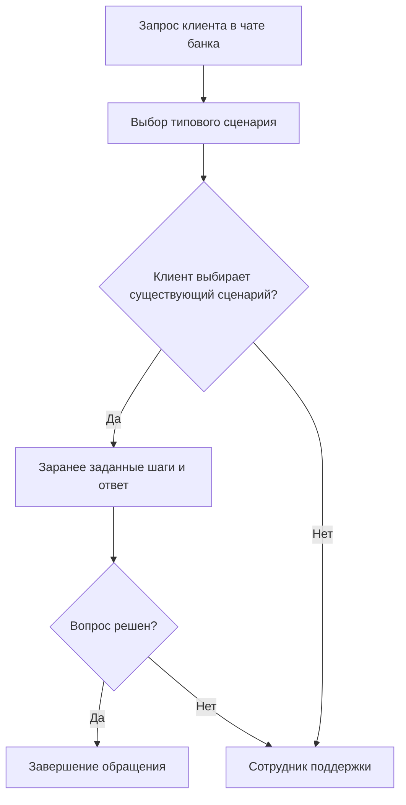
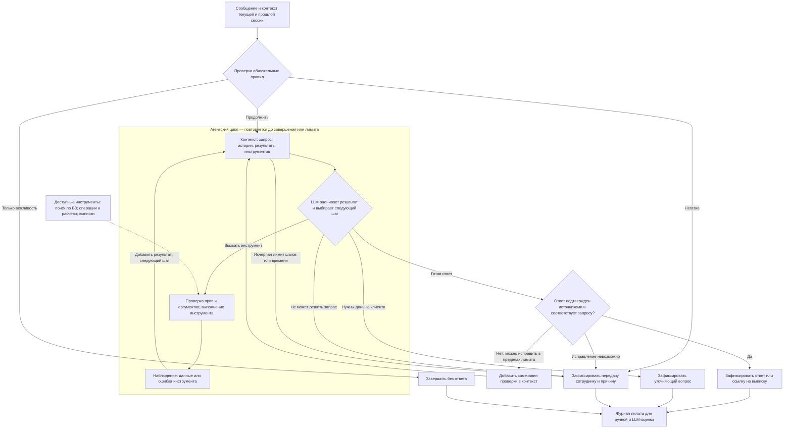

# ML System Design Doc - [RU]
## Дизайн ML системы - \<Продукт\> \<MVP or Production System\> \<Номер\>
    
> ## Термины и пояснения
> - Итерация - это все работы, которые совершаются до старта очередного пилота  
> - БТ - бизнес-требования 
> - EDA - Exploratory Data Analysis - исследовательский анализ данных  
> - `Product Owner`,  `Data Scientist` - роли, которые заполняют соответствующие разделы 
> - В этом шаблоне роль `Data Scientist` совмещает в себе компетенции классического `Data Scientist` с упором на исследования и `ML Engineer` & `ML Ops` роли с акцентом на продуктивизацию моделей
> - Для вашей организации распределение ролей может быть уточнено в зависимости от операционной модели 

### 1. Цели и предпосылки 
#### 1.1. Зачем идем в разработку продукта?  

- Цель продукта - автоматизировать обработку входящих сообщений от клиентов в чат-поддержку приложения. 
Сейчас на все сообщения отвечает сотрудники чат-поддержки, типовые кейсы решает чат-бот. DAU чатов 100 тыс, сотрудников, которые отвечают на вопросы, около 1000 человек. Текущй чат-бот позволяет достичь автоматизации в 50%, есть амбиция к росту. 
Вторая задача - улучшить клиентский опыт. По исследованию Frank в 2025 году 61% респондентов предпочитает оператора чат-боту, в частности из-за того, что сценарии чат-бота сильно ограничены и он часто не понимает запроса клиента. За счет внедрения ИИ попытаемся сделать общение с клиентом более человекоцентричным. 

- Почему станет лучше. Чат-бот отвечает только на набор типовых, заранее прописанных нами сценариев, из которых клиент должен выбирать свой. С помощью GenAI хотим начать лучше понимать намерение клиента из текста вопроса, расширить список вопросов, на которые сможем отвечать и добавить активные сценарии - например, анализ ленты операций или выгрузку банковских выгрузок. Агентская архитектура поможет быстрее и гибче встраивать новые сценарии. 

- Успехом будет рост метрики автоматизации. Амбиция - +10% до конца 2027 года.

#### 1.2. Бизнес-требования и ограничения  

- *Бизнес-требования:*
1. Решение должно уметь отвечать на вопросы клиентов, опираясь на существующую клиентскую базу знаний.  
2. Решение должно уметь:
 2.1. Выделять паттерны негативного поведения клиента
 2.2. Выделять паттерны срочных вопросов
 2.3. Определять тематики вопроса - например, вопросы по кешбэку или по текущему обслуживанию. Тематики будут направлены бизнес-заказчиком
 2.4. Уметь формировать выписки клиентам
 2.5. Уметь отвечать на вопросы по ленте операций
 2.6. Уметь совершать по запросу клиента операции в разделе небанковских сервисах, вроде travel, страхование и прочее (следующие итерации, будет проработано)
 2.7. Уметь предлагать и выбирать клиенту категории кешбэка (будет проработано позднее) 
3. В пункте 2.1 запрос нужно направлять сотруднику поддержки.
4. Если запрос клиента оказался слишком сложным, чтобы его решить, его нужно направить на сотрудника поддержки

- *Бизнес-ограничения*
1. На информационные вопросы решение должно отвечать строго по актуальной клиентской базе знаний банка. Если информации недостаточно, необходимо уточнить запрос или передать его сотруднику.
2. Весь негатив обязательно нужно передавать человеку
3. Если это сообщение вежливости, вроде "спасибо", "ок" и прочее, на него не нужно отвечать
4. Для формирования ответа нужно использовать контекст текущей и прошлой сессии

- *Что мы ожидаем от конкретной итерации* `Product Owner`. 

MVP решение, которое умеет отвечать на вопросы из базы знаний, формировать выписки и отвечать на темы ленты операций и при необходимости передавать запрос клиентской службе. В конкретной интерации подключать решение в чат не нужно, достаточно будет того, что сообщения будут приходить в ассистента, чтобы мы могли перед выводом на клиента оценить качество работы.

- *Описание бизнес-процесса пилота* `Product Owner`

1. Пилот проводится без вывода ответов в клиентский чат. Инициирующие сессию сообщения клиентов поступают в ассистента, ответы логгируются. Срок пилота - 2 недели. 
2. Из сформированных диалогов DS формируют выборки для разметки. Важно, чтобы выборка содержала в себе все use cases из БТ ~ одинакового размера 
3. Мы одновременно отдаём валидационную выборку команде разметки на ручную оценку и одновременно делаем автооценку LLM и смотрим на качетсов ответов. Команда получает ответ LLM и сравнивает с ответами оператора. Предварительно из выборки убираются кейсы, где сотрудник КЦ не решил корректно запрос клиента - важно сравнивать ответ LLM с хорошим ответом сотрудника.

- *Что считаем успешным пилотом? Критерии успеха и возможные пути развития проекта* `Product Owner`

1. **Основная метрика — доля обращений, решённых корректно.** Сможем посчитать по результату разметки.
2. **Рост доли автоматизации** - из обращений важно понять, с какими вопросами не справился чат-бот, но справился ассистент. Исходя из результатов сможем сделать вывод о потенциале роста автоматизации 
3. **Достоверность и правдивость ответов, на основе базы знаний** - посмотрим по результату разметки

Параллельно анализируем, с какими сценариями агент не справился и формируем новые гипотезы по внедрению нового функционала.

#### 1.3. Что входит в скоуп проекта/итерации, что не входит   

**Входит в первую итерацию (MVP):**

- Ответы на вопросы по согласованным тематикам клиентской базы знаний — БТ 1.
- Определение негативного поведения, срочности и тематики обращения — БТ 2.1–2.3. Список тематик и правила разметки предоставляет бизнес-заказчик.
- Формирование выписки по выбранному счету и периоду через банковский сервис — БТ 2.4.
- Ответы по ленте операций: поиск операции, отбор по периоду и суммирование расходов по доступным полям — БТ 2.5. Расчеты выполняются программно по данным API, модель формулирует результат.
- Уточнение недостающих параметров и передача сложных запросов или обращений с негативным поведением сотруднику — БТ 3–4. 
- Интеграция с чатом приложения, без возможности в чат писать, журналирование решений и вызовов инструментов, сравнение с текущим чат-ботом.

**Не входит в первую итерацию:**

- Ответы на вопросы во фронт-системе
- Действия в небанковских сервисах, включая travel и страхование — БТ 2.6.
- Рекомендация и выбор категорий кешбэка — БТ 2.7.
- Денежные переводы, платежи, изменение условий обслуживания и автономное решение вопросов вне согласованных сценариев.
- Голосовой канал, другие каналы обслуживания, полный перевод клиентской поддержки на ИИ.
- Ручка вызова оператора физически не будет вызывать человека - нужна для оценки решения

#### 1.4. Предпосылки решения  

1. В банке есть клиентская база знаний с действующими условиями продуктов и обслуживания.
2. Доступна история чатов, содержащая сообщения клиента и поддержки, маршруты передачи сотруднику и, по возможности, результат обращения и клиентскую оценку. 
3. Бизнес предоставляет список тематик, критерии негативного поведения и срочности. На их основе размечается набор диалогов для настройки и оценки классификации.
4. Единица обработки — текущее сообщение с необходимой историей диалога; единица оценки автоматизации — завершенное обращение.
5. Текущий сценарный чат-бот с указанной автоматизацией 50% используется как бейзлайн.

### 2. Методология `Data Scientist`     

#### 2.1. Постановка задачи  

С технической точки зрения строим диалогового агента для чат-поддержки банка с ручкой поиска по базе знаний (RAG), вызовом банковских API и маршрутизацией обращений сотрудникам.

**Вход:** сообщение клиента и контекст сессии. Дополнительные источники — база знаний, доступные MCP.

**Задачи системы:**

1. Классифицировать обращение: определить тематику и независимые признаки негативного поведения и срочности. Выбрать маршрут: ответ по базе знаний, работа с операциями, формирование выписки, уточнение или сотрудник.
2. Найти релевантные фрагменты базы знаний и сформировать ответ, подтверждаемый этими материалами. При отсутствии достаточных сведений не выдавать предположение за факт.
3. Извлечь параметры действия: счет, период, признаки искомой операции. Запросить недостающие значения, проверить параметры и права доступа, вызвать соответствующий инструмент. Выписку формирует банковский сервис; расчеты по операциям выполняются кодом.
4. Проверить результат: соответствие запросу и источникам, успешность вызова API и отсутствие раскрытия чужих данных. При ошибке, недостатке сведений или исчерпании лимита шагов передать обращение сотруднику.

**Выход:** ответ клиенту, ссылка на сформированную выписку в защищенном канале, уточняющий вопрос либо переданный сотруднику диалог с причиной передачи.

Качество оценивается на нескольких уровнях: полнота выявления срочных и негативных обращений, F1 по тематикам, полнота поиска нужного материала, доля корректных ответов и успешных действий. Пороговые значения устанавливаются по результатам оценки бейзлайна и согласуются до пилота.

#### 2.2. Блок-схема решения  

**Бейзлайн — действующий сценарный чат-бот.** 

**Основной MVP — агент с набором tools.** После каждого вызова инструмента его результат добавляется в контекст, и агент заново выбирает следующий шаг. Последовательность инструментов заранее не задается: агент может повторить поиск, обратиться к операциям, сформировать выписку или завершить обработку.

#### 2.3. Этапы решения задачи `Data Scientist`  

- Для каждого этапа **по результатам EDA** описываем - **отдельно для бейзлайна** и **отдельно для основного MVP** - все про данные и технику решения максимально конкретно. Обозначаем необходимые вводные, технику предполагаемого решения и что ожидаем получить на выходе, чтобы перейти к следующему этапу.  
- Как правило, детальное и структурированное заполнение раздела `2.3` возможно только **по результатам EDA**.  
- Если описание в дизайн доке **шаблонно** - т.е. его можно скопировать и применить к разным продуктам, то оно **некорректно**. Дизайн док должен показывать схему решения для конкретной задачи, поставленной в части 1.  
    
> Примеры этапов:  
> - Этап 2 - Подготовка прогнозных моделей  
> - Этап 3 - Интерпретация моделей (согл. с заказчиком)  
> - Этап 4 - Интеграция бизнес правил для расчета бизнес-метрик качества модели  
> - Этап 5 - Подготовка инференса модели по итерациям    
> - Этап 6 - Интеграция бизнес правил  
> - Этап 7 - Разработка оптимизатора (выбор оптимальной итерации)  
> - Этап 8 - Подготовка финального отчета для бизнеса  

*Этап 1 - это обычно, подготовка данных.*  

В этом этапе должно быть следующее:  

- Данные и сущности, на которых будет обучаться ваша модель машинного обучения. Отдельная таблица для целевой переменной (либо целевых переменных разных этапов), отдельная таблица – для признаков.  
  
| Название данных  | Есть ли данные в компании (если да, название источника/витрин) | Требуемый ресурс для получения данных (какие роли нужны) | Проверено ли качество данных (да, нет) |
| ------------- | ------------- | ------------- | ------------- |
| Продажи | DATAMARTS_SALES_PER_DAY  | DE/DS | + |
| ...  | ...  | ... | ... |
 
- Краткое описание результата этапа - что должно быть на выходе: витрины данных, потоки данных, др.  
  
> Чаще всего заполнение раздела невозможно без EDA.

 *Этапы 2 и далее, помимо подготовки данных.*
 
Описание техники **для каждого этапа** должно включать описание **отдельно для MVP** и **отдельно для бейзлайна**:  

- Описание формирования выборки для обучения, тестирования и валидации. Выбор репрезентативных данных для экспериментов, обучения и подготовки пилота (от бизнес-цели и репрезентативности данных с технической точки зрения) `Data Scientist`    
- Горизонт, гранулярность, частоту необходимого пересчета прогнозных моделей `Data Scientist`   
- Определение целевой переменной, согласованное с бизнесом `Data Scientist`   
- Какие метрики качества используем и почему они связаны с бизнес-результатом, обозначенным `Product Owner` в разделах `1` и `3`. Пример - WAPE <= 50% для > 80% категорий, bias ~ 0. Возможна формулировка в терминах относительно бейзлайна, количественно. Для бейзлайна могут быть свои целевые метрики, а может их вообще не быть (если это обосновано) `Data Scientist`   
- Необходимый результат этапа. Например, необходимым результатом может быть не просто достижение каких-либо метрик качества, а включение в модели определенных факторов (флаг промо для прогноза выручки, др.) `Data Scientist`    
- Какие могут быть риски и что планируем с этим делать. Например, необходимый для модели фактор (флаг промо) окажется незначимым для большинства моделей. Или для 50% моделей будет недостаточно данных для оценки `Data Scientist`    
- Верхнеуровневые принципы и обоснования для: feature engineering, подбора алгоритма решения, техники кросс-валидации, интерпретации результата (если применимо).  
- Предусмотрена ли бизнес-проверка результата этапа и как будет проводиться `Data Scientist` & `Product Owner`  
  
### 3. Подготовка пилота  
  
#### 3.1. Способ оценки пилота  
  
- Краткое описание предполагаемого дизайна и способа оценки пилота `Product Owner`, `Data Scientist` with `AB Group` 
  
#### 3.2. Что считаем успешным пилотом  
  
Формализованные в пилоте метрики оценки успешности `Product Owner`   
  
#### 3.3. Подготовка пилота  
  
- Что можем позволить себе, исходя из ожидаемых затрат на вычисления. Если исходно просчитать сложно, то описываем этап расчетов ожидаемой вычислительной сложности на эксперименте с бейзлайном. И предусматриваем уточнение параметров пилота и установку ограничений по вычислительной сложности моделей. `Data Scientist` 

### 4. Внедрение `для production систем, если требуется`    

> Заполнение раздела 4 требуется не для всех дизайн документов. В некоторых случаях результатом итерации может быть расчет каких-то значений, далее используемых в бизнес-процессе для пилота.  
  
#### 4.1. Архитектура решения   
  
- Блок схема и пояснения: сервисы, назначения, методы API `Data Scientist`  
  
#### 4.2. Описание инфраструктуры и масштабируемости 
  
- Какая инфраструктура выбрана и почему `Data Scientist` 
- Плюсы и минусы выбора `Data Scientist` 
- Почему финальный выбор лучше других альтернатив `Data Scientist` 
  
#### 4.3. Требования к работе системы  
  
- SLA, пропускная способность и задержка `Data Scientist`  
  
#### 4.4. Безопасность системы  
  
- Потенциальная уязвимость системы `Data Scientist`  
  
#### 4.5. Безопасность данных   
  
- Нет ли нарушений GDPR и других законов `Data Scientist`  
  
#### 4.6. Издержки  
  
- Расчетные издержки на работу системы в месяц `Data Scientist`  
  
#### 4.5. Integration points  
  
- Описание взаимодействия между сервисами (методы API и др.) `Data Scientist`  
  
#### 4.6. Риски  
  
- Описание рисков и неопределенностей, которые стоит предусмотреть `Data Scientist`   
  
> ### Материалы для дополнительного погружения в тему  
> - [Шаблон ML System Design Doc [EN] от AWS](https://github.com/eugeneyan/ml-design-docs) и [статья](https://eugeneyan.com/writing/ml-design-docs/) с объяснением каждого раздела  
> - [Верхнеуровневый шаблон ML System Design Doc от Google](https://towardsdatascience.com/the-undeniable-importance-of-design-docs-to-data-scientists-421132561f3c) и [описание общих принципов его заполнения](https://towardsdatascience.com/understanding-design-docs-principles-for-achieving-data-scientists-53e6d5ad6f7e).
> - [ML Design Template](https://www.mle-interviews.com/ml-design-template) от ML Engineering Interviews  
> - Статья [Design Documents for ML Models](https://medium.com/people-ai-engineering/design-documents-for-ml-models-bbcd30402ff7) на Medium. Верхнеуровневые рекомендации по содержанию дизайн-документа и объяснение, зачем он вообще нужен  
> - [Краткий Canvas для ML-проекта от Made with ML](https://madewithml.com/courses/mlops/design/#timeline). Подходит для верхнеуровневого описания идеи, чтобы понять, имеет ли смысл идти дальше.  
